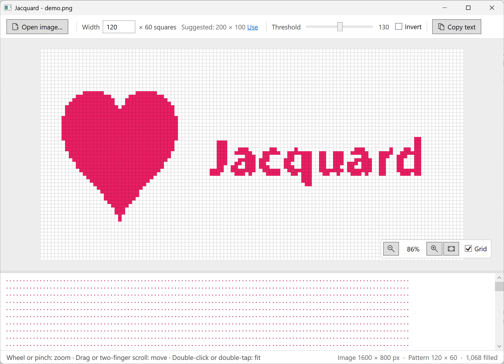

# Jacquard

A small Windows tool that turns an image into a **jacquard pattern**: a grid of filled and empty squares you can follow when knitting, weaving or cross-stitching, or paste into Excel.



## Features

- **Open** an image with the button, by dropping it on the window, or with "Open with" (PNG, JPG, BMP, GIF, TIFF).
- **Width** in squares; the height follows the image's proportions. Leave it empty for a **suggested width** (about 20,000 squares, based on the image's shape). Values that can't work are explained: more than 640, wider than the image itself, or too many squares.
- **Threshold:** pixels darker than it become filled squares. **Invert** fills the light parts instead.
- **Zoom and move** with the mouse (wheel, drag, double-click to fit), a touchpad (pinch, two-finger scroll) or a touch screen (pinch, drag, double-tap to fit). Grid lines appear when you zoom in.
- **Copy text:** the pattern as `1` (filled) and a space (empty), with a tab after each square, so it pastes into Excel one square per cell.
- The work runs in the background with a progress bar, so the window never freezes, even on large photos.

## Usage

1. Download `Jacquard-v1.0.0-win.7z` from [Releases](https://github.com/Mohammad-Diab/Jacquard/releases) and extract it with [7-Zip](https://www.7-zip.org).
2. Run `Jacquard.exe` and open an image.
3. Adjust the width and threshold until the pattern looks right, then press **Copy text** or follow it on screen.

Keyboard: `Ctrl+O` open, `Ctrl` `+` / `-` zoom, `Ctrl+0` fit.

## How it works

The image is resized to the chosen width with high-quality bicubic sampling. Each pixel's perceived brightness is `√(0.241·R² + 0.691·G² + 0.068·B²)`; transparent pixels count as white. A pixel darker than the threshold becomes a filled square.

## Build

Open `Jacquard.sln` in Visual Studio, or run:

```
dotnet build Jacquard -c Release
```

It targets .NET Framework 4.8, which is part of Windows 10 and 11. The first version (2020) targeted .NET Framework 4.5.

## License

[MIT](LICENSE)
